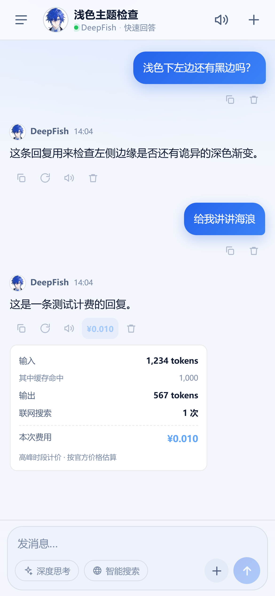

# DeepFish

A lightweight, open-source DeepSeek client for **Android and iOS**, where every
conversation can have its own persona — name, prompt and avatar.

> 中文文档见 [README.md](README.md)



## Features

- **Per-conversation personas** — different name, system prompt and avatar for every chat
- **Thinking & web search toggles** — remembered per conversation
- **Image and file input** — powered by `deepseek-flash`
- **Read aloud** — official DeepSeek TTS (voice `tide`), with an auto-read switch in the top bar
- **Token usage & cost** — every reply shows its CNY cost; tap for the token breakdown
- **Import from DeepSeek** — parse the official `deepseek_data-*.zip` export, pick which conversations to keep
- **Custom chat background** — crop and zoom your own image per conversation
- **Local-first** — everything stays on device; JSON backup and restore
- **Markdown** — tables, code blocks with copy, citations, collapsible reasoning

## Quick start

### Android

Download the latest APK from [Releases](../../releases), or build it yourself:

```bash
npm install
npx cap add android
npx cap copy android
npm run apk
```

### iOS

Requires macOS + Xcode:

```bash
npm install
npx cap add ios
npx cap copy ios
npx cap open ios
```

### Web / PWA

`www/` is a fully static app. Deploy it anywhere and open over HTTPS, then
"Add to Home Screen" in Safari or Chrome.

```bash
npx serve www
```

Then open the app, read the notice, and paste your DeepSeek API key
(from <https://platform.deepseek.com/api_keys>) in Settings.

## Compatibility

| Platform | Status |
|---|---|
| Android 5.1 → 16 | ✅ tested (vivo iQOO, Huawei Mate 20 / HarmonyOS 4.0) |
| iOS 15+ (PWA) | ✅ responsive, safe-area, no input zoom |
| iOS native | buildable, needs a Mac to sign |
| Desktop browsers | ✅ (Chromium 90+, Safari 15+, Firefox 100+) |

The code is written in ES5-flavoured JavaScript on purpose, and CSS avoids
`:has()`, `dvh`, `color-mix()` so older system WebViews can still run it.
See [CONTRIBUTING.md](CONTRIBUTING.md) for the compatibility checklist.

## How it works

```
DeepSeek API  ⇄  fetch (SSE, CORS-enabled)  ⇄  WebView / browser
                                                   │
                                          IndexedDB (local only)
```

The app talks to `api.deepseek.com` directly from the WebView — no proxy,
no server. Your API key never leaves the device.

## Disclaimer

This is an **unofficial, non-commercial open-source project**. It is not
affiliated with, endorsed by, or connected to DeepSeek Inc.

The default icon and avatar use a character design by **子午老师 (Ziwu)**,
used with permission. That artwork is **not** covered by the MIT license.

## License

[MIT](LICENSE) for the code. Artwork excluded.
