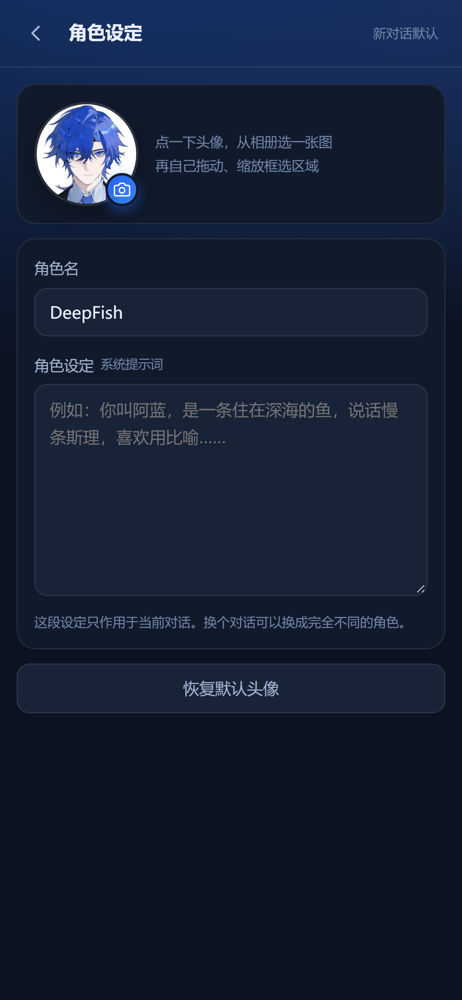
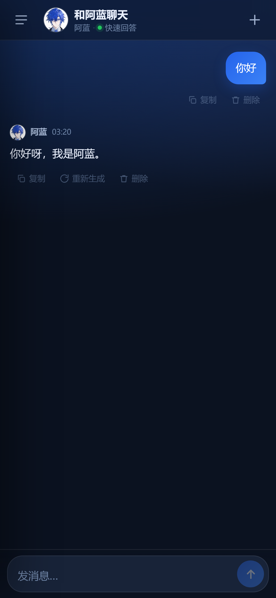
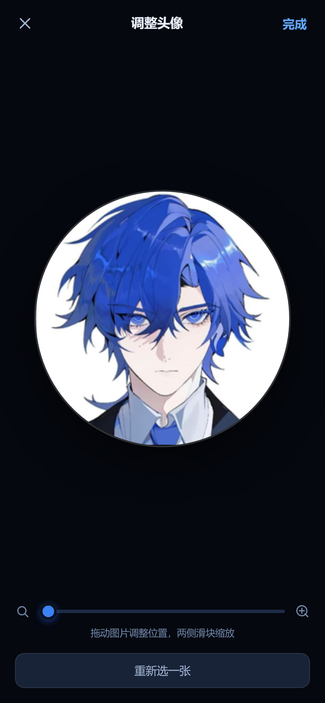

# DeepFish

[English](README.en.md) | 中文

一个可以装在手机上的 DeepSeek 客户端，**每个对话都能有自己独立的角色**——
角色名、性格设定、头像都可以分开设置，互不影响。



| 多角色对话 | 角色设定 | 头像裁剪 |
|---|---|---|
|  |  |  |

---

## 一、先用起来

### 方式 A：安装 APK（推荐，安卓 / 华为手机）

1. 在 `dist/` 目录里找到 **`DeepFish-v1.11.0.apk`**（4.3 MB）
2. 传到手机上（微信文件传输、数据线、网盘都行）
3. 手机上点开安装包 → 允许「安装未知来源应用」→ 安装
4. 打开桌面上的「DeepFish」，首次进入点「先填写 API Key」填入你的 Key 即可

> 华为 HarmonyOS 4.0（Mate 20 / HMA-AL00）完全兼容。
> 若被「纯净模式」拦截：设置 → 系统和更新 → 纯净模式 → 退出纯净模式。
> 这个包使用**固定签名**（`xiaolan-release.jks`，有效期 30 年），
> 以后的新版本可以直接覆盖安装，数据不会丢。

### 方式 B：电脑本地运行（浏览器直接打开）

1. 双击项目根目录的 **`启动DeepFish.cmd`**
2. 会自动打开浏览器访问 `http://127.0.0.1:5180/`
3. 手机和电脑连同一个 Wi-Fi，用手机浏览器打开 `http://电脑的局域网IP:5180/` 也能用

> 需要装 Node.js。没有的话脚本会提示你去 nodejs.org 下载。

### 方式 C：部署成一个网址（PWA）

把 `www/` 整个目录传到任意静态托管（GitHub Pages、Vercel、Netlify、Gitee Pages、自己的服务器），
用 HTTPS 打开后，浏览器菜单里会出现「添加到主屏幕」，装出来就是带图标的独立 App，支持离线打开。

---

## 二、第一次使用

1. 打开 App → 点中间的「**先填写 API Key**」
2. 填入 DeepSeek 开放平台的 Key（形如 `sk-xxxxxxxx`），在 <https://platform.deepseek.com/api_keys> 创建
3. 点「测试连接」，成功会提示可用模型
4. 返回对话页就能聊了

**API Key 只保存在本机**，不会上传到任何第三方服务器；所有请求由你的手机直接发往 `api.deepseek.com`。

---

## 三、角色系统（这一版的重点）

### 每个对话都是一套独立的角色

| 字段 | 说明 |
|---|---|
| 角色名 | 顶栏和消息头像旁显示的名字 |
| 角色设定 | 也就是系统提示词，描述它的身份、语气、世界观 |
| 头像 | 默认用 App 图标，可以换成任意相册照片 |

这些字段存在**每个对话自己身上**，所以你可以：

- 对话 A 用「高冷剑客」，对话 B 用「活泼学妹」；
- 给每个 OC 配不同的头像；
- 随时回某个旧对话，改它的角色，不影响其他对话。

### 怎么设置

**顶栏左边的头像 / 角色名** → 打开当前对话的「角色设定」

- 改角色名、写设定，输入即保存
- 点头像 → 从相册选图 → 拖动位置 / 拖滑块缩放 → 「完成」
- 头像会被裁成 256×256 存进本地，不占什么空间

### 新对话的默认角色

设置 → 「新对话的默认角色」

- 这里的名字和设定会被**新建对话**继承
- 已经存在的对话不受影响，各自保留自己的角色

### 头像裁剪怎么用

1. 点击角色面板里的圆形头像
2. 从相册选一张图
3. 在大圆里**拖动图片**调整位置，拖**底部滑块**缩放
4. 圆里看到什么，头像就是什么
5. 点右上角「完成」

---

## 四、能做什么

| 功能 | 说明 |
|---|---|
| 多角色 | 每个对话独立的名字 / 设定 / 头像 |
| 深度思考 | 输入框开关，按对话独立记忆。开启后先推理再回答 |
| 联网搜索 | 输入框开关，模型自动搜索并附「参考来源」 |
| 图片输入 | + 号上传图片，模型可看图（需 deepseek-flash） |
| 朗读 | 喇叭按钮，用官方 TTS「暗潮」音色朗读回复 |
| 聊天背景 | 每个对话可换自己的背景图 |
| 导入对话 | 把 DeepSeek 的旧对话搬过来，保留上下文 |
| 流式回答 | 逐字输出，带打字光标，可随时「停止生成」 |
| 深度思考 | `deepseek-reasoner` 的思考过程可折叠查看 |
| Markdown | 标题、列表、表格、引用、粗体、链接、代码块（一键复制） |
| 多会话 | 自动起标题、按今天/昨天分组、搜索、删除 |
| 参数调节 | 携带历史条数、temperature、max_tokens |
| 外观 | 深色 / 浅色 / 跟随系统，三档字号 |
| 数据 | 导出 JSON 备份、导入恢复、本机自动快照（最多 7 份） |

---

## 五、数据与备份（重要）

### 数据存在哪

- 全部对话、角色、头像、设置都存在手机 App 自己的存储里（IndexedDB）
- 卸载 App 会一起删掉，所以**换手机、重装前请先导出备份**

### 导出备份

设置 → 数据与备份 → **导出备份文件**

- 生成一个 `xiaolan-backup-年月日-时分.json`（文件名沿用旧前缀，不影响使用）
- 在 APK 里会弹出系统「分享」面板，可以存到「文件管理」、发给自己、传到网盘
- 在浏览器里会直接下载到"下载"目录
- 备份里可以不含 API Key（更安全），恢复后再填一次就行
- **角色设定和头像也会一起备份**

### 导入恢复

设置 → 数据与备份 → **导入备份文件** → 选择 json 文件

- **合并导入**：保留现有对话，新增备份里的
- **替换导入**：清空现有对话，完全用备份覆盖
- 两种方式都会保留本机已填的 API Key

### 版本升级为什么不丢数据

- **APK 升级**：同一个签名覆盖安装，Android 保留 WebView 数据目录 → 对话不丢
- **PWA / 网页部署**：数据按"域名"隔离，更新代码不影响存储
- **额外保险**：每次对话结束会写入本机快照（最多 7 份，间隔 8 分钟）

---

## 六、关于技术选型（Tauri vs Capacitor）

| | Tauri 2 | Capacitor（本项目采用） |
|---|---|---|
| 安卓构建链 | Rust 交叉编译 + NDK + SDK + JDK | 只要 SDK + JDK |
| 首次构建耗时 | 通常 20～40 分钟 | 2～3 分钟 |
| 安装包体积 | 3～6MB | 4～10MB |

这个 App 是纯前端（HTML/CSS/JS，无框架、无构建步骤），用 Capacitor 套 WebView 外壳最合适：
代码一行不用改，以后想改界面直接改 `www/` 里的文件，重新打包即可。

⚠️ 关键前提已验证：`api.deepseek.com` 的响应头带
`access-control-allow-origin`（回显来源）并允许 `authorization` 头，
**所以 WebView 里可以直接跨域请求，不需要额外写原生代理**。

> `www/` 目录也可以直接作为 Tauri 的 `distDir` 使用，页面代码零改动。

### 本机已装好的构建链

| 组件 | 位置 |
|---|---|
| JDK 17 | `D:\NewNew_Tools\android-build\jdk17\jdk-17.0.21.0.2+1` |
| Android SDK | `D:\NewNew_Tools\android-build\android-sdk` |
| 签名文件 | `xiaolan-release.jks`（密码 `xiaolan2026`，别名 `xiaolan`） |

---

## 七、自己重新打包 APK

```bat
set JAVA_HOME=D:\NewNew_Tools\android-build\jdk17\jdk-17.0.21.0.2+1
set ANDROID_HOME=D:\NewNew_Tools\android-build\android-sdk
cd xiaolan-deepseek
npx cap copy android
cd android
gradlew.bat assembleRelease
```

产物：`android/app/build/outputs/apk/release/app-release.apk`，复制到 `dist/` 即可。

> 只改 `www/` 里的页面时不需要 `npm install`，`cap copy` + `assembleRelease` 十几秒。
> 改过插件依赖才需要 `npx cap sync android`。

### 重新生成图标

改了原图后：

```bat
python tools\make_icons.py
python tools\make_android_res.py
```

原图放在 `assets/avatar-square.png`（正方形，只做缩放，不重新构图）。

---

## 八、跨平台兼容（Android / iOS）

| 平台 | 状态 |
|---|---|
| Android 5.1 ~ 16 | ✅ 实测 vivo iQOO、华为 Mate 20（HarmonyOS 4.0） |
| iOS 15+（PWA） | ✅ 安全区、防输入缩放、音频解锁都已处理 |
| iOS 原生 | 可构建，但需要 macOS + Xcode 签名 |
| 桌面浏览器 | ✅ Chromium 90+ / Safari 15+ / Firefox 100+ |

> **为什么不用 `transform` 把面板移出屏幕来隐藏？**
> 因为部分设备的合成层不会正确裁剪移出屏幕的元素，会留下一层**看不见的全屏遮罩**，
> 把所有点击都吃掉。iQOO 上那个「整屏点不动」的 bug 就是这么来的。
> 现在所有全屏面板在关闭时都是 `visibility: hidden; pointer-events: none`，
> 并且启动后会自检一次，把异常可见的面板强制隐藏。

### iOS 上怎么用

没有 Mac 也能用：把 `www/` 部署到任意 HTTPS 静态托管，Safari 打开后
「共享 → 添加到主屏幕」，效果接近原生，支持离线。

有 Mac 的话可以打原生包：

```bash
npx cap add ios
npx cap copy ios
npx cap open ios
```

### iOS 与其他平台的已知差异

- 导出备份走系统「分享 / 存储到文件」，不是直接下载
- 朗读需要用户点一次喇叭解锁音频（iOS 的自动播放限制），之后自动朗读正常
- 导入 `deepseek_data-*.zip` 需要 iOS 16.4+（系统解压能力），更早版本会提示改用 JSON
- 桌面浏览器上，部分系统会拦截自动播放，同样点一下即可

## 九、华为 Mate 20（HMA-AL00 / HarmonyOS 4.0）适配说明

| 项目 | 情况 | 本项目的处理 |
|---|---|---|
| 系统 | HarmonyOS 4.0（AOSP 内核，兼容 APK） | minSdk 22，targetSdk 34，可正常安装 |
| 屏幕 | 1080×2244，约 360×748 dp | 全布局按 360dp 设计，触摸区≥44dp |
| 内核 | 系统 WebView（Chromium 99 级别） | 只用 Chromium 90 已支持的 CSS/JS |
| 水滴屏 | 顶部挖孔 | `viewport-fit=cover` + `env(safe-area-inset-*)` |
| 输入法 | 键盘弹出压缩视口 | `visualViewport` 实时算高度，自动滚到底 |
| 性能 | 麒麟 980 | 流式输出用文本节点追加，不整段重排 |
| 持久化 | — | IndexedDB + localStorage 双保险 |

---

## 十、常见问题

**Q：提示"API Key 无效或已过期"？**
A：Key 复制错了，或者账户没余额。去 <https://platform.deepseek.com> 检查。

**Q：一直转圈没有回复？**
A：先在设置里点「测试连接」。如果测试也失败，检查手机网络，或把「接口地址」改成 `https://api.deepseek.com`。

**Q：怎么让不同对话扮演不同的人？**
A：在每个对话里点顶栏头像，分别设置角色名和设定即可。它们互不影响。

**Q：换手机怎么迁移？**
A：旧手机导出备份 → 把 json 传到新手机 → 新手机装 App → 导入备份 → 合并导入。
角色和头像也会一起带过去。

**Q：卸载重装后数据没了？**
A：卸载会清除数据。请务必先导出备份。

**Q：对话越来越长会卡吗？**
A：设置里的「携带历史消息」控制发给模型的数量（默认 20 条），不影响本地保存的完整记录。

---

## 十一、目录结构

```
xiaolan-deepseek/
├─ 启动DeepFish.cmd        ← 双击运行（电脑浏览器）
├─ www/                    ← 应用本体（纯静态，可直接部署）
│  ├─ index.html
│  ├─ css/app.css
│  ├─ js/  app.js api.js store.js md.js
│  ├─ icons/               ← 由原图生成的全部图标
│  ├─ manifest.webmanifest
│  └─ sw.js                ← 离线缓存
├─ android/                ← Capacitor 安卓工程
├─ dist/                   ← 打包好的 APK
├─ assets/                 ← 原图、图标母版、界面截图
├─ tools/                  ← 图标生成、本地服务器、测试脚本
└─ README.md
```

---


### 检查更新

设置 → 关于 → 「检查更新」，会去 GitHub 查最新的 Release：

- 有新版：弹出提示，点「去下载」复制下载链接（APK 优先，没有则给 Release 页面）
- 已最新：提示当前版本
- 还没发过 Release：提示「作者还没有发布正式版本」

> 作者发布新版本时，记得在 GitHub 上 **Create a release** 并上传 APK，
> 标签用 `v1.8.0` 这种格式。只有打了 Release，「检查更新」才能读到。

## 开源协议

本项目把**代码**和**美术资产**分开授权：

| 部分 | 许可 | 能否商用 |
|---|---|---|
| 代码（`www/`、`android/`、`tools/`） | [MIT](LICENSE) | ✅ 可以 |
| 美术（图标、默认头像、截图中的角色形象） | [NOTICE](NOTICE) 第 2 节 | ❌ 不可以 |

**角色形象**由 **子午老师** 设计。作者已在公开简介里授权使用这个形象，
条件是**不得用于商业用途**。所以在个人项目、非商业项目、以及本项目的 fork 里都可以用。

要商用的话，请另行联系作者，或者直接把 `www/icons/` 和 `assets/` 里的图换成你自己的——
代码不需要任何修改，换掉图片就能跑。

> 顺带说明：OSI 定义下的「开源」本身就允许商用，所以「开源 + 不许商用」没法用同一个许可证表达。
> 把代码和美术拆成两个许可，是这类项目的标准做法（很多带角色的开源项目都这么处理）。

本项目是非官方第三方客户端，与 DeepSeek 官方没有隶属或合作关系。

贡献前请先读 [CONTRIBUTING.md](CONTRIBUTING.md)，里面有兼容性检查清单。
